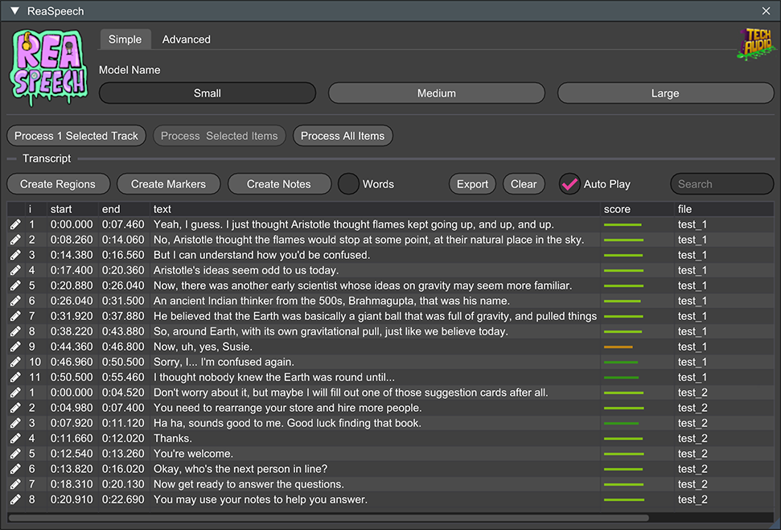

# ReaSpeech

### Painless speech-to-text transcription inside REAPER

ReaSpeech is a ReaScript interface for transcribing REAPER media items. It
builds a searchable, project-marker-based transcript while keeping REAPER
responsive during recognition. Find that perfect take, jump to a spoken phrase,
or give your scrubbing finger a well-earned break.

## Requirements

- REAPER
- [ReaImGui](https://github.com/cfillion/reaimgui) 0.10 or newer
- ReaSpeech Lib installed in REAPER's `UserPlugins` directory

## Install

Add the Team Audio repository to ReaPack:

    https://github.com/TeamAudio/reascripts/raw/main/index.xml

Install **ReaSpeech** and one **ReaSpeech Lib** backend from ReaPack, then run
ReaSpeech from REAPER's Actions window. The script is self-contained; its only
runtime dependencies are ReaImGui and ReaSpeech Lib.

Select one or more media items and click **Transcribe Selected Items**.
Recognition runs asynchronously, with progress and cancellation available in
the existing ReaSpeech interface.

## Coming from the Docker version?

Starting with ReaSpeech 1.0, transcription runs through ReaSpeech Lib instead of
the Docker-hosted web service. Docker and the local web server are no longer
required. To move from 0.7.x or another Docker-based version:

1. Close the old ReaSpeech window. Install **ReaSpeech** and one **ReaSpeech
   Lib** backend through ReaPack using the instructions above, then restart
   REAPER to load the extension.
2. In REAPER's Actions window, run the ReaPack-installed ReaSpeech script.
   Update any shortcuts or toolbar buttons that launch your old downloaded
   script to use this action instead. The old script still expects the web
   service; installing the new version does not update that separate copy.
3. Transcribe a media item to check your new setup. Once it works, stop your
   old ReaSpeech Docker container and disable any automatic startup for it.
   You can remove the old script's action once your shortcuts have been updated.

You do not need to uninstall Docker or remove containers used by other tools.

If you still need an older Docker-based version, the legacy images remain on
[Docker Hub](https://hub.docker.com/r/techaudiodoc/reaspeech). We will continue
hosting them for a limited time, so please plan to move to the new version.
The old setup instructions are preserved in the
[0.7.3 documentation](https://github.com/TeamAudio/reaspeech/tree/v0.7.3/docs).

## Get involved

Found a bug, have a question, or want to help? Visit the
[issue tracker](https://github.com/TeamAudio/reaspeech/issues), read our
[contribution guidelines](docs/CONTRIBUTING.md), or see
[Development](docs/development.md) to build and test ReaSpeech.

## Credits

### ReaSpeech team

- [Dave Benjamin](https://github.com/ramen)
- [Jason Nanna](https://github.com/smrl)
- [Kyle Vande Slunt](https://github.com/kvande-standingwave)
- [Michael DeFreitas](https://github.com/mikeylove)
- [Roel Sanchez](https://github.com/roelsan)

### Open source projects

- [ReaSpeech Lib](https://github.com/TeamAudio/reaspeech-lib) provides the
  transcription engine.
- [ReaImGui](https://github.com/cfillion/reaimgui) by Christian Fillion powers
  the user interface.
- [OpenMoji](https://openmoji.org) provides the emoji icons, licensed under
  [CC BY-SA 4.0](https://creativecommons.org/licenses/by-sa/4.0/).
- [json.lua](https://github.com/rxi/json.lua) by rxi handles JSON, and
  [LuaUnit](https://github.com/bluebird75/luaunit) supports our tests.

Our earlier Docker-based versions built on
[Whisper ASR Webservice](https://github.com/ahmetoner/whisper-asr-webservice)
and [Faster Whisper](https://github.com/SYSTRAN/faster-whisper). Thank you to
their contributors for helping ReaSpeech get its start.

## License

ReaSpeech is distributed under the GNU General Public License v3.0. See
[LICENSE](LICENSE). Third-party components retain their own licenses; the
earlier web service included code derived from the MIT-licensed Whisper ASR
Webservice project.
